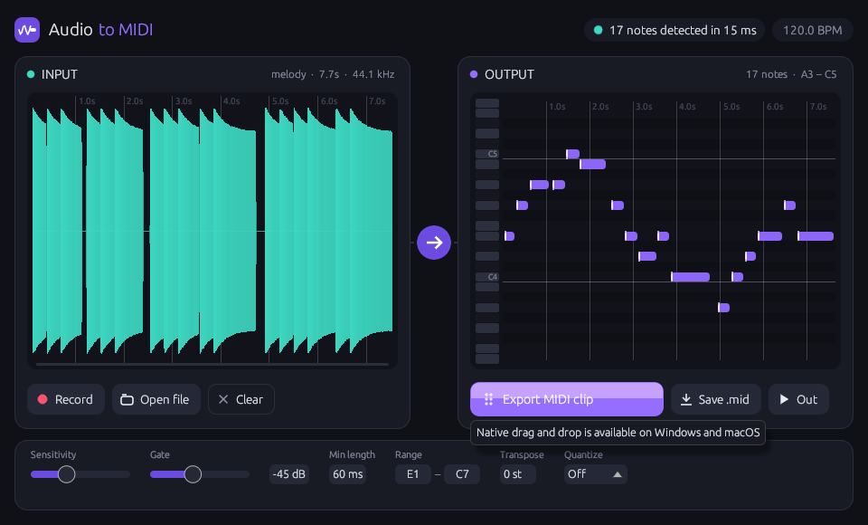

# Audio To MIDI

VST3 / CLAP плагин на Rust, который превращает аудиодорожку в MIDI. Результат можно
перетащить мышкой прямо из окна плагина на MIDI-дорожку или в piano roll DAW.



## Интерфейс

Два окна, связанных общей шкалой времени:

| **INPUT** | **OUTPUT** |
|---|---|
| Waveform входного сигнала и индикатор уровня | Piano roll с распознанными нотами |
| **Record**: записывает звук, который идёт через плагин (вешаете его на дорожку и запускаете воспроизведение) | **Drag MIDI into your DAW**: зажмите и перетащите MIDI-клип в DAW |
| **Open file**: WAV, AIFF, FLAC, MP3, OGG | **Save .mid**: сохранить файл |
| **Clear**: очистить | **Out**: проигрывать ноты через MIDI-выход плагина синхронно с транспортом DAW, чтобы записать их на MIDI-дорожку |

Нижняя панель с настройками:

* **Sensitivity**: порог YIN. Чем выше, тем больше нот находится в шумном или «дышащем» материале,
  но тем больше и мусора.
* **Gate**: всё, что тише порога, считается тишиной.
* **Min length**: более короткие ноты отбрасываются.
* **Range**: диапазон нот, в котором ищется высота тона.
* **Transpose**: сдвиг результата в полутонах.
* **Quantize**: квантизация экспортируемого MIDI по темпу DAW (1/4 … 1/32).

После записи, загрузки файла или изменения настроек анализ запускается автоматически, в фоновом
потоке. Результат и настройки сохраняются вместе с проектом.

## Как это работает

1. Сигнал сводится в моно, проходит через фильтр нижних частот и ресэмплируется до ~11 кГц.
2. Основная частота ищется для каждого кадра (шаг ~6 мс) алгоритмом **YIN**. Разностная функция
   считается через автокорреляцию на FFT (`realfft`), поэтому 3-минутный трек обрабатывается
   за доли секунды.
3. Трек высоты сглаживается медианным фильтром. Затем он режется на ноты: учитываются гистерезис
   по высоте, атаки по резкому росту громкости, паузы и минимальная длина. Отдельно убираются
   артефакты на легато-переходах.
4. Velocity считается из пиковой громкости ноты.

Анализ **монофонический**: вокал, бас, лид, духовые, свист. Аккорды и полифонию он не разберёт.

## Сборка

Нужен Rust (stable).

```bash
cargo xtask bundle audiotomidi --release
```

Готовые плагины появятся в `target/bundled/`:

* `Audio To MIDI.vst3`: скопируйте в
  * Windows: `C:\Program Files\Common Files\VST3\`
  * macOS: `~/Library/Audio/Plug-Ins/VST3/`
  * Linux: `~/.vst3/`
* `Audio To MIDI.clap`: тот же плагин в формате CLAP (Bitwig, Reaper, FL Studio 2024+…)

Для macOS можно собрать universal binary:

```bash
cargo xtask bundle-universal audiotomidi --release
```

На Linux для сборки нужны dev-пакеты X11/OpenGL:

```bash
sudo apt install libx11-xcb-dev libxcursor-dev libxcb-icccm4-dev libxcb-dri2-0-dev libgl-dev libwayland-dev libxkbcommon-dev
```

### Standalone и утилиты для разработки

```bash
cargo run --release --features standalone --bin audiotomidi_standalone
```

```bash
cargo run --release --example analyze -- input.wav output.mid
```

```bash
cargo test --release
```

## Особенности и ограничения

* **Drag & drop** из окна плагина реализован нативно для Windows (OLE `DoDragDrop`) и macOS
  (`NSDraggingSession`) через crate [`drag`](https://crates.io/crates/drag). На Linux кнопка
  вместо этого сохраняет `.mid` через диалог.
* Перетаскиваемый файл создаётся во временной папке (`%TEMP%/audiotomidi`, `$TMPDIR/audiotomidi`).
  Темп в файле берётся из DAW.
* Режим **Out** (MIDI-выход) работает в DAW, которые поддерживают MIDI-выход у аудиоэффектов
  (Reaper, Bitwig, Cubase, FL Studio и др.). Ableton Live не принимает MIDI из VST3-эффектов,
  там используйте drag & drop.
* Если запись начата во время воспроизведения, MIDI-выход ставит ноты на ту же позицию таймлайна,
  с которой шла запись.
* Перетаскивать аудиофайлы *в* плагин пока нельзя: оконный бэкенд (baseview + egui) не передаёт
  событие drop. Используйте **Open file**.

## Стек

* [nih-plug](https://github.com/robbert-vdh/nih-plug): фреймворк плагинов (VST3 + CLAP)
* [egui](https://github.com/emilk/egui) через `nih_plug_egui`: GUI
* `realfft`, `symphonia`, `midly`, `rfd`, `rtrb`, `drag`

## Лицензия

GPL-3.0-or-later. VST3-обёртка nih-plug использует GPLv3-биндинги VST3 SDK, поэтому
распространяемые VST3-бинарники должны быть под GPLv3.
